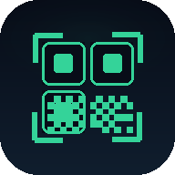

# QR Screen — escáner de QR por pantalla (sin cámara)

App Android que lee códigos QR **directamente de la pantalla del celular**. No usa la cámara:
captura la pantalla con `MediaProjection` y decodifica los píxeles con ZXing.

**Descargar:** [APK firmado 1.0.1](dist/QR-Screen-1.0.1.apk) · **Página web:** <https://profilebiome.github.io/qr-screen/>



## Cómo funciona

1. El botón **Escanear pantalla** pide la captura del sistema y arranca un servicio en primer plano.
2. Un `VirtualDisplay` entrega los fotogramas a un `ImageReader`; se recorta el área del visor y,
   si no hay lectura, se prueban la pantalla completa reducida y a resolución nativa.
3. ZXing decodifica el QR (con búsqueda agresiva, binarizador global e intento invertido para modo
   oscuro). Al encontrar un código, vibra, suena y muestra la tarjeta de resultado.
4. El texto queda en el historial local; nada sale del teléfono porque el APK no tiene permiso de
   internet.

## Qué hace

- **Escaneo en vivo**: botón «Escanear pantalla» → permiso de captura → aparece un visor flotante
  sobre cualquier app, navegador, PDF, video o chat. Cuando detecta un código, muestra una tarjeta
  con **Copiar / Abrir / Compartir**.
- **Detección automática**: primero mira el área del marco y después barre toda la pantalla
  (reducida y a resolución nativa), así que el QR no tiene que estar perfectamente centrado.
- **Modo ajuste**: desde la píldora «Ajustar» se puede mover y redimensionar el marco; el área se
  guarda para la próxima vez.
- **Desde imagen**: decodifica una foto o captura de la galería, o una imagen compartida a QR Screen.
- **Historial**: últimas 100 lecturas, guardadas solo en el dispositivo, con copiar/abrir/compartir.
- **Sin cámara**: el manifest no declara `android.permission.CAMERA`.

## Instalar

1. Copia `dist/QR-Screen-1.0.1.apk` al teléfono (cable, Drive, Telegram…).
2. Ábrelo y acepta «Instalar apps desconocidas» para el explorador/gestor de archivos.
3. Al abrir la app:
   - concede **Mostrar sobre otras apps** (visor y tarjeta de resultados),
   - concede **Notificaciones** (Android 13+),
   - al pulsar «Escanear pantalla», acepta la **captura de pantalla** del sistema.

> La aceptación de captura se pide cada vez que inicias el escáner: es un requisito de Android.
> La app nunca pide cámara ni acceso a internet.

### «No se puede verificar la app» / «Play Protect»

Ese aviso **lo pone Android, no la app**, y aparece con cualquier APK instalado fuera de Google
Play. No hay ningún ajuste dentro del APK que lo quite: la única forma de eliminarlo del todo es
publicar en Play Store. Para instalar igualmente:

- Toca **Más detalles → Instalar de todas formas** (o «Instalar sin analizar»).
- Si el teléfono lo bloquea: **Play Store → foto de perfil → Play Protect → ⚙ → desactiva
  «Analizar apps con Play Protect»** durante la instalación y vuelve a activarlo después.
- En Xiaomi/POCO/HyperOS, además: **Ajustes → Privacidad → Protección → desactivar «Analizar apps
  instaladas»**, y activa «Instalar vía USB» en Opciones de desarrollador.
- Si dice **«App no instalada»** suele ser porque ya hay una versión con otra firma:
  desinstala la anterior y vuelve a instalar.

### Instalar por USB (sin avisos del gestor de archivos)

Con depuración USB activada, ejecuta `instalar-adb.bat` en Windows (o a mano:
`adb install -r dist/QR-Screen-1.0.1.apk`). Es la vía más limpia y permite ver el motivo exacto si
la instalación falla.

### ¿Es maliciosa?

No. Auditoría del APK:

- **Sin permiso de INTERNET**: no puede enviar nada a ningún servidor.
- **Sin cámara, sin contactos, sin ubicación, sin almacenamiento.**
- Permisos: servicio en primer plano, proyección de pantalla, notificaciones, dibujar sobre otras
  apps y vibración. Todos son los que necesita el escáner para funcionar.
- Una sola dependencia (ZXing core, decodificador libre de Google), sin analítica ni SDK de
  terceros; un único `classes.dex`, sin librerías nativas.
- Firma propia (`keystore/qrscreen.jks`), verificada con `apksigner` (v1+v2+v3).

El código fuente completo está en este repositorio para que cualquiera lo revise y recompile.

## Cómo se usa

1. Pulsa **Escanear pantalla** y acepta la captura.
2. La app se minimiza sola; abre la app donde esté el QR.
3. Apunta con el marco (o deja que detecte en cualquier parte).
4. En la tarjeta: **Copiar**, **Abrir** (enlaces, teléfono, correo) o **Compartir**.
5. Para terminar: **✕** en la píldora superior, **Detener** en la notificación o en la app.

## Si no detecta

- Sube el **brillo** de la pantalla y evita filtros de luz nocturna muy agresivos.
- Usa **Ajustar** para encuadrar el código dentro del marco.
- Los QR muy pequeños o con mucho movimiento (video) tardan un poco más: la app reintenta cada
  ~0,2 s.
- En Xiaomi/Redmi, POCO, OPPO, vivo, Realme: activa «Inicio automático» y quita la optimización de
  batería para QR Screen, o el sistema puede cerrar el servicio en segundo plano.

## Compilar

Requisitos: JDK 17 y Android SDK con platform 34 y build-tools 34.0.0.

La firma se lee de `keystore.properties` (ignorado por git, junto con `keystore/`). Ese archivo no
se publica: el repositorio solo incluye el APK ya firmado. Sin él, `assembleRelease` genera un APK
sin firma y `assembleDebug` sigue funcionando.

```bash
# local.properties con sdk.dir apuntando al SDK
./gradlew :app:assembleRelease
# APK firmado: app/build/outputs/apk/release/app-release.apk
```

Comprobar la firma y los permisos:

```bash
apksigner verify -v --print-certs dist/QR-Screen-1.0.1.apk
aapt2 dump badging dist/QR-Screen-1.0.1.apk | findstr permission
```

Firma: keystore propio (RSA 2048, esquemas v2 y v3) para poder instalar actualizaciones encima
sin desinstalar. La clave no forma parte del repositorio público.

## Web

La página de descarga está en `index.html` y se publica con GitHub Pages desde la raíz del repo.
Incluye el botón de descarga del APK, qué hace la app, los pasos de instalación y la ficha técnica.
Copia local: abre `index.html` con doble clic (el APK se sirve desde `dist/`).

## Licencia

MIT. Consulta [LICENSE](LICENSE).

## Estructura

```
app/src/main/java/com/drako/qrscreen/
  MainActivity.java        UI principal, permisos, galería, historial
  ScreenScanService.java   servicio en primer plano + bucle de escaneo
  ScreenCapture.java       MediaProjection, VirtualDisplay, ImageReader, recorte de píxeles
  QrDecoder.java           ZXing: QR tryHarder, binarizador global, invertido, 1D
  ScanOverlay.java         píldora, mira, modo ajuste y tarjeta de resultado
  QrImage.java             decodificar desde galería/imagen compartida
  HistoryStore.java        historial en SharedPreferences
  Actions.java             copiar/abrir/compartir/vibrar
  Ui.java / HeroArtView.java  estilos y dibujo de la ilustración
```

## Límites conocidos

- El sistema incluye el propio visor en la captura: por eso el marco se dibuja fuera del área de
  lectura y el escaneo se pausa mientras se muestra la tarjeta.
- Apps con `FLAG_SECURE` (banca, DRM) aparecen en negro y no se pueden leer; es una protección
  del sistema, no de la app.
- La pantalla de bloqueo también queda negra por seguridad del sistema.
